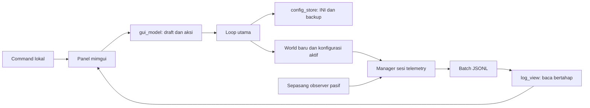

# AimLock 1.4.0: GUI konfigurasi dan log

Arsip versi 1.4.0. Versi terbaru [1.5.0](AimLock-GUI-1.5.0.md) memakai panel minimal dua menu, satu command `/apanel`, Alt + X dan identitas author pada GUI/chat. Prosedur `/aimlock`, `/aimlog` dan Ctrl + X di bawah hanya berlaku untuk 1.4.0. Snapshot source lama kemudian ditambahkan ke repo melalui commit terpisah; kebijakan publikasi update 1.5.0 dijelaskan di dokumen terbaru.

Versi ini menambahkan panel mimgui dengan sidebar Konfigurasi, Distribusi, Telemetry, dan Log. Aim Tracking, Weighted Aim Point Distribution, Ctrl + X, dan pengamatan telemetry pasif dari 1.3.0 tetap tersedia. Tidak ada mekanisme baru yang memaksa hit, mengubah payload, atau menembak otomatis.

## Instalasi dan dependensi

| Komponen | Pemakaian |
| --- | --- |
| GTA San Andreas Windows, SA-MP, MoonLoader, SAMPFUNCS | Lingkungan game dan API tracking / telemetry yang sudah digunakan |
| LuaJIT / Lua 5.1 | Bahasa; `ffi` bawaan LuaJIT mengakses kernel32 untuk menyimpan INI di Windows |
| mimgui v1.7.1 | GUI Dear ImGui + DX9; dependensi baru dan opsional untuk keseluruhan script |
| Node.js, luamin 1.0.4, luaparse 0.3.1 | Tools build obfuscation; hanya pada workstation pengembangan |

Salin `moonloader/AimLock1.4.0.lua` dan `moonloader/config/AimLock1.4.0.ini` ke folder yang sama pada instalasi GTA. Pasang satu versi script. Unduh [ZIP mimgui resmi v1.7.1](https://github.com/THE-FYP/mimgui/releases/download/v1.7.1/mimgui-v1.7.1.zip), ekstrak folder `mimgui` ke `moonloader/lib/mimgui/`. ZIP resmi berisi `init.lua`, `imgui.lua`, `cdefs.lua`, `dx9.lua`, `win32.lua`, dan `cimguidx9.dll`; seluruh isinya diperlukan. ZIP telah diunduh dan struktur tersebut diperiksa saat implementasi.

Folder source `lib/AimLockDistribution` tidak dibutuhkan oleh bundle. File manifest `.json` berisi checksum distribusi dan tidak dipasang. File `.jsonl` adalah log yang dibuat otomatis di `moonloader/logs/`; jangan meletakkannya di `lib`. Tidak diperlukan `vkeys`, `encoding`, SAMP.Lua, atau paket ffi tambahan.

Jika mimgui/ffi/API command tidak tersedia, startup menuliskan alasan GUI OFF ke `moonloader.log`; INI, Ctrl + X, dan tracking tetap dapat digunakan. Telemetry juga dapat berjalan tanpa GUI. Kerusakan fatal saat memuat DLL pihak ketiga berada di luar kemampuan `pcall` Lua.

## Alur penggunaan

1. Buka `/aimlock`. Sidebar memilih halaman; `/aimlog` langsung membuka Log.
2. Ubah field pada draft. Halaman Distribusi menunjukkan total enam bobot dan kesalahan validasi. Bobot harus nonnegatif dan total 100%; bobot nol valid. Field desimal dari GUI memakai empat tempat desimal agar pembulatan float mimgui tidak merusak total.
3. Pilih **Terapkan** untuk sesi berjalan. **Simpan & Terapkan** juga menulis INI dan backup. Status ON/OFF saat ini dipertahankan; checkbox **Aktif saat script dimuat** mengatur `enabled` untuk startup berikutnya.
4. **Muat INI**, **Default**, dan **Batalkan draft** hanya mengubah draft. Muat INI tidak langsung mengubah konfigurasi aktif. Status panel membedakan draft belum diterapkan dengan konfigurasi aktif yang belum disimpan.
5. Tutup memakai Escape, tombol Tutup panel, atau X jendela. Baru gunakan Ctrl + X dan klik kanan untuk tracking. Selama panel terbuka, target dilepas, kamera tidak ditulis, dan chord Ctrl + X diabaikan.

Panel menahan kontrol pemain melalui `OnFrame().LockPlayer`. Saat game tidak aktif, pause, chat, dialog, console, belum spawn atau koneksi tidak siap, panel disembunyikan sementara; tracking tetap diblokir. Draft dipertahankan ketika panel ditutup. Penutupan panel tidak menyimpan otomatis. Ukuran teks 1x..2x berlaku untuk sesi GUI, tidak ditulis ke INI. Navigasi keyboard diaktifkan melalui `NavEnableKeyboard`; jendela dapat diubah ukurannya dan area konten dapat discroll.

## Konfigurasi dan penyimpanan

INI lengkap tersedia pada [AimLock1.4.0.ini](../moonloader/config/AimLock1.4.0.ini). Seluruh key 1.3.0 tetap valid. Key baru berada di `[aimlock]`:

```ini
gui_enabled=true
gui_command=aimlock
gui_log_command=aimlog
```

Nama command harus berbeda, 1..20 karakter huruf kecil ASCII/angka/underscore, diawali huruf, tanpa slash. Nama command dan `gui_enabled` diterapkan saat script dimuat. Sesudah menyimpannya, reload script. Pendaftaran memeriksa `sampIsChatCommandDefined`; command yang bentrok tidak ditimpa. Command lain yang bebas tetap didaftarkan. Pemeriksaan ini mendeteksi command client yang sudah terdaftar, bukan daftar command gamemode server atau script yang mendaftar sesudahnya.

Pengaturan tracking meliputi jarak 1..300, FOV 0.01..0.5, offset tinggi -1..1 dan koordinat crosshair 0..1. Distribusi mencakup random ON/OFF, interval integer 100..5000 ms, seed `auto` / integer 1..2147483646, serta enam bobot. Default bobot tetap 20/20/20/15/15/10 mengikuti konfigurasi pengguna sebelumnya. Telemetry mencakup ON/OFF, jendela korelasi integer 50..3000 ms dan interval tulis integer 100..10000 ms. Seed tetap mengulang urutan setelah penerapan karena engine dibuat ulang.

Simpan melakukan validasi terlebih dahulu, menulis `.ini.tmp`, lalu menulis salinan byte INI lama ke `.ini.bak.tmp`. Setelah seluruh write/close sukses, `MoveFileExA` mengganti `.bak`, kemudian INI asli, memakai `MOVEFILE_REPLACE_EXISTING | MOVEFILE_WRITE_THROUGH`. Kegagalan backup atau penggantian mempertahankan INI asli dan tidak menerapkan draft. Backup selalu isi file sebelum save terakhir; `.tmp` milik operasi dibersihkan saat gagal. Penyimpanan menulis konfigurasi kanonis sehingga komentar INI lama dipertahankan di backup, bukan di INI baru. Penyimpanan memerlukan INI awal yang dapat dibaca, folder yang dapat ditulis, dan jalur Windows yang dapat diakses API ANSI. Ini bukan koordinasi multiwriter; hindari mengedit file bersamaan dari beberapa proses.

Setiap Terapkan membuat ulang World/AimPoint, melepas target dan mengakhiri sesi telemetry lama, lalu memulai sesi baru bila telemetry diaktifkan. Handler observer tetap satu pasang melalui proxy manager. Nama sesi menambahkan nomor urut agar penerapan pada milidetik yang sama tidak menyatukan dua sesi. Jika pencatatan baru gagal, tracking tetap diterapkan dan halaman Telemetry menampilkan status OFF beserta alasan. Handler yang gagal terpasang sebagian / dinonaktifkan karena kegagalan pemulihan cursor memerlukan reload script.

## Membaca log

File aktif bernama `moonloader/logs/AimLock1.4.0-YYYYMMDD-HHMMSS-<game_ms>-<urutan>.jsonl`. Nomor urut berlaku selama script dimuat. **Sesi aktif** memilih path telemetry terbaru; ketika konfigurasi diterapkan, file yang sedang dibaca tidak otomatis diganti agar log sebelumnya masih dapat diperiksa. Pilih Sesi aktif lagi untuk beralih. File mungkin belum ada sebelum flush pertama.

**Daftar ulang file** memindai maksimal 256 nama `AimLock*.jsonl`, mengurutkan nama menurun, lalu menampilkan maksimal 64 path. Urutan nama bukan urutan modifikasi file lintas versi. File sesi aktif juga dimasukkan sebelum batas daftar diterapkan. Bila API pencarian file tidak tersedia, sesi aktif masih dapat dipilih. Nama yang berisi pemisah path ditolak. Dropdown hanya memilih file lokal pada folder logs.

Pembacaan bertahap maksimal 64 KiB per poll; refresh otomatis setiap 500 ms selama halaman Log terbuka. Baris terakhir yang belum memiliki newline ditahan sampai lengkap. Baris rusak, scalar JSON, dan baris di atas 64 KiB dilewati dengan penghitung. File yang mengecil dibaca ulang dari awal. Memori dibatasi oleh 1.000 event dan 2 MiB teks mentah (ditambah cache pencarian dan objek JSON); event tertua dilepas saat salah satu batas terlampaui. File besar dapat memerlukan beberapa refresh. File diganti dengan isi berbeda berukuran sama tidak selalu terdeteksi; pilih kembali file untuk membaca dari awal.

Filter event, ID target tepat, dan pencarian teks literal tanpa membedakan huruf besar/kecil bekerja pada event yang sudah dimuat. **Bersihkan tampilan** mengosongkan event di memori, mempertahankan offset baca, dan tidak memodifikasi file. Pilih ulang file untuk memuat ulang dari awal. Tabel menampilkan timer game, event, target, titik aim pilihan, body part laporan, dan status server. Pilih baris untuk detail JSON asli, termasuk waktu sistem, senjata, koordinat dan kandidat korelasi bila tersedia.

Data adalah laporan keluar dari client; `server_status=unknown` tetap berlaku. Tidak adanya laporan damage tidak diberi label confirmed miss. Kandidat temporal, termasuk kandidat tunggal, bukan konfirmasi server. Schema dan batas korelasi lainnya tetap mengikuti [dokumentasi telemetry 1.3.0](AimLock-shot-telemetry-1.3.0.md).

## Struktur dan arsitektur aktual

| Modul lokal | Tanggung jawab |
| --- | --- |
| config, random, engine, aim_point | Validasi bobot, RNG mandiri, weighted draw, pemilihan titik berdasarkan waktu |
| camera, controller, world | Perhitungan kamera, status Ctrl + X, pencarian/validasi target dan snapshot |
| settings | Parsing/validasi seluruh konfigurasi, termasuk command GUI |
| telemetry, telemetry_observer, telemetry_journal, telemetry_runtime | Antrean event, observer baca saja, batch JSONL dan manager sesi dengan satu pasang handler |
| config_store | Serialisasi INI dan save dengan backup/penggantian Windows yang diinjeksi |
| gui_model | Draft, validasi, status aktif/tersimpan dan antrean aksi konfigurasi |
| log_view | Pembacaan JSONL bertahap, batas memori, filter dan pilihan event |
| gui | Renderer panel/sidebar, field dan tabel/detail log |
| gui_runtime | Memuat mimgui/ffi melalui host require, command, callback frame, kernel32 dan poll GUI |

Entry `moonloader/AimLock.lua` menghubungkan 17 modul tersebut. Source dan namespace `AimLockDistribution` tetap lokal; hanya bundle obfuscated yang dipublikasi. Modul GUI tidak melakukan I/O dari callback draw: render mengubah draft/filter atau mengantrekan aksi, lalu loop utama memproses save, apply dan baca log. Scope GUI ditutup saat render Lua gagal dan GUI dinonaktifkan. Kesalahan operasi/file ditampilkan sebagai pesan sehingga main tetap berjalan. Shutdown melepaskan subscription GUI dan menutup telemetry.



## Arah tampilan dan verifikasi UI

Sidebar dan area log luas mengikuti pilihan pengguna. Panel gelap solid mengurangi gangguan dari latar game. Font bawaan mimgui mempertahankan keterbacaan/kompatibilitas tanpa font tambahan. Aksen `#A9D6FF` mengikuti identitas chat AimLock dan menandai fokus serta kontrol; tanpa dekorasi atau animasi tambahan. Dial ENERGY 1 / RHYTHM 2 / MOTION 1: form konfigurasi ringkas, log memakai tabel dan detail yang lebih luas, hanya respons kontrol bawaan. Scroll dan slider ukuran teks menjaga kontrol tetap dapat dijangkau pada ruang yang lebih kecil.

| Gate | Bukti / status |
| --- | --- |
| PASS: perilaku kontrol dan state (R-24, R-26, R-27) | Tes renderer stub mengaktifkan seluruh halaman, field, toolbar, kontrol log, ukuran teks dan penutupan; pesan kosong/error/loading berasal dari state aktual |
| PASS: kontras palet terukur (R-25) | contrast-check.py: teks #EDF2F7 pada hover #34495E 8.25:1; teks sekunder #B8C4D0 5.24:1; border #8CA3B8 3.56:1; aksen #A9D6FF 6.08:1; teks pada pilihan #536D84 4.79:1 dan pilihan terhadap panel #18212B 3.01:1 |
| PASS: tujuan visual dan isi (R-17, R-18, R-20, R-29, R-31, R-37) | Arah sidebar dipilih pengguna; tabel memuat event file lokal tanpa contoh palsu; satu palet/aksen; alasan layout/warna/font tertulis di atas |
| PASS: build dan cakupan interaksi otomatis (R-35, lingkup otomatis) | Bundle diperiksa Lua 5.1; suite menguji jalur klik/edit dan keseimbangan Begin/End pada renderer stub |
| Belum diverifikasi: native UI (R-03, R-32, R-34, R-35) | Tidak tersedia sesi GTA/MoonLoader DX9; tampilan nyata, tab/fokus keyboard, cursor, kontrol pemain, scrolling, resolusi dan skala 2x belum dibuktikan dalam game |

Gate native UI tetap terbuka; hasil otomatis tidak dinyatakan sebagai kelulusan visual dalam game.

## SOP build, tes dan publikasi

```powershell
npm.cmd ci --prefix tools --ignore-scripts --no-audit --no-fund
npm.cmd run build --prefix tools
npm.cmd run check --prefix tools
luajit tests/aimlock_spec.lua moonloader/AimLock1.4.0.lua
luajit tests/shot_telemetry_spec.lua moonloader/AimLock1.4.0.lua
luajit tests/gui_spec.lua moonloader/AimLock1.4.0.lua
luajit tests/windows_io_spec.lua moonloader/AimLock1.4.0.lua
```

Build memerlukan source lokal. Test bundle tidak memerlukan `lib/AimLockDistribution`. Test mimgui memakai `tests/gui_fixture.lua`; library mimgui nyata tidak diperlukan oleh suite stub. Jalankan tes dari root repo. Lua 5.1 dapat menjalankan tiga suite logika; Windows I/O memerlukan Windows LuaJIT ffi dan menyatakan SKIP jika tidak ada.

Publikasikan hanya artifact `AimLock1.4.0.lua`, manifest, INI, tools, tes dan dokumentasi yang berubah. Stage nama file eksplisit; jangan stage source `AimLock.lua`, `lib/AimLockDistribution`, arsip source, perubahan `.gitignore` lokal, atau file JSONL. Verifikasi manifest SHA256 dan tes dari clone bersih sebelum push `HEAD:dev` ke remote `samp`. Obfuscation mempersulit pembacaan, tidak menjamin source tak dapat dipulihkan.

Pengujian implementasi: 29 kelompok aim tracking, 26 telemetry dan 19 GUI, seluruhnya lulus pada source maupun bundle 1.4.0 di LuaJIT 2.0.1774896119, LuaJIT 2.1.1774896198 dan Lua 5.1 (444 kelulusan kelompok tes; nol gagal). Suite mencakup validasi, draft/apply/save, kegagalan file/backup/replacement, partial JSONL, baris rusak/besar, batas memori, filter, kontrol renderer, command bentrok, fallback library, error render, pemblokiran kamera saat GUI terbuka, dan observer yang tidak bertambah saat configure berulang. Tes Windows I/O juga lulus pada source/bundle di kedua LuaJIT: penggantian, backup, file terkunci dan retry dengan kernel32 serta file sementara nyata. Runtime pengujian berasal dari Lupa Windows x64 pada direktori sementara, bukan MoonLoader x86 di GTA; Lupa bukan dependensi instalasi script. Build/check memverifikasi sintaks Lua 5.1, main/onExitScript dan kesesuaian artifact dengan source/config lokal.

Pengujian I/O tambahan menghasilkan tujuh event JSONL menggunakan Lua io di Windows dan adapter JSON Python: seluruh baris terurai, damage target 7 dapat difilter, refresh tidak menduplikasi event, dan Bersihkan tampilan tidak membaca ulang isi lama. Ini membuktikan jalur file/parser yang diinjeksi, bukan implementasi native `decodeJson` MoonLoader.

API diperiksa terhadap [referensi MoonLoader dari THE-FYP](https://gist.github.com/THE-FYP/abc6f8bea87f4cb42331fc6dd7a84576), [implementasi OnFrame/OnInitialize mimgui](https://github.com/THE-FYP/mimgui/blob/master/lua/init.lua), wrapper/cdefs dalam ZIP mimgui v1.7.1, dan [dokumentasi Microsoft MoveFileExA](https://learn.microsoft.com/en-us/windows/win32/api/winbase/nf-winbase-movefileexa). API baru seperti `sampIsChatCommandDefined`, `sampRegisterChatCommand`, `findFirstFile/findNextFile/findClose`, dan `decodeJson` diperiksa sebelum integrasi; tersedia guard/fallback saat tidak tersedia.

Uji manual berikut masih perlu dilakukan pada instalasi GTA pengguna: buka/tutup kedua command, Tab/Enter/Escape, skala/resolusi layar, setiap field dan pesan validasi, Simpan & Terapkan lalu reload, log live dan pergantian sesi, pause/chat/dialog, Ctrl + X saat panel dibuka/ditutup, dan kompatibilitas mod lain. Server hit acceptance dan pose/bone accuracy tidak diverifikasi oleh tes GUI ini.
