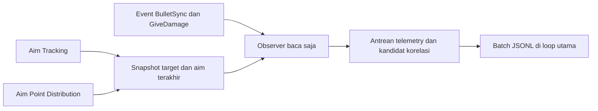

# AimLock 1.3.0: Shot Telemetry

Dokumen ini merekam versi 1.3.0. Versi terbaru [1.4.0](AimLock-GUI-1.4.0.md) menambahkan GUI konfigurasi/log, live apply, save INI dengan backup dan manager telemetry yang memakai ulang observer. Nama sesi terbaru menambahkan nomor urut. Schema laporan dan batas interpretasi di bawah tetap relevan; instalasi terbaru mengikuti dokumen 1.4.0.

## Arsitektur tiga modul

| Lapisan | Implementasi | Tanggung jawab |
| --- | --- | --- |
| Aim Tracking | controller.lua, world.lua, camera.lua | Mempertahankan pemain target, memeriksa validitas, dan mengikuti geraknya |
| Aim Point Distribution | config.lua, random.lua, engine.lua, aim_point.lua | Memilih area tubuh berbobot dan mempertahankan pilihan selama interval |
| Shot Telemetry | telemetry.lua, telemetry_observer.lua, telemetry_journal.lua, telemetry_runtime.lua | Mengamati laporan tembakan/damage dan menyimpan bukti beserta snapshot aim |

`settings.lua` memvalidasi konfigurasi ketiga lapisan. Source aktif tetap `moonloader/AimLock.lua` dengan namespace `AimLockDistribution`. File distribusi [AimLock1.3.0.lua](../moonloader/AimLock1.3.0.lua) membundel dua belas modul. Source pengembangan disimpan lokal dan tidak disertakan dalam publikasi.



Telemetry tidak memanggil engine random, memilih target, mengubah sudut kamera, menulis payload, atau mengirim tembakan. Aktivitas kamera tetap berasal dari dua modul yang sudah ada pada [versi 1.2.0](AimLock-random-aim-1.2.0.md). Ctrl + X mengendalikan aim tracking; telemetry mempunyai pengaturan aktif sendiri sehingga data tembakan saat aim OFF tetap dapat dicatat sebagai pembanding.

## Instalasi dan konfigurasi

Salin [AimLock1.3.0.lua](../moonloader/AimLock1.3.0.lua) ke `moonloader/` dan [AimLock1.3.0.ini](../moonloader/config/AimLock1.3.0.ini) ke `moonloader/config/`. Pasang satu versi script. Tidak perlu memasang folder lib atau manifest JSON. JSONL dibuat otomatis saat runtime di:

```text
moonloader/logs/AimLock1.3.0-YYYYMMDD-HHMMSS-<game_ms>.jsonl
```

Nama file memakai waktu lokal sistem dan timer game saat sesi dibuat. `session_id` pada setiap event sama dengan nama dasar file. Folder log dibuat bila belum ada; `.gitignore` pada folder log mengecualikan `AimLock*.jsonl` dari publikasi.

Pengaturan baru dalam section `[aimlock]`:

```ini
telemetry_enabled=true
telemetry_match_window_ms=750
telemetry_flush_interval_ms=1000
```

| Key | Aturan |
| --- | --- |
| telemetry_enabled | true/false; default true; terpisah dari status Ctrl + X |
| telemetry_match_window_ms | integer 50..3000; default 750; jendela kandidat hubungan laporan |
| telemetry_flush_interval_ms | integer 100..10000; default 1000; interval tulis batch |

Konfigurasi tracking, distribusi 20/20/20/15/15/10, seed, dan interval random 300 ms tetap tersedia. Perubahan INI diterapkan setelah reload atau mulai ulang game. Key/section tidak dikenal, duplikat, tipe salah, nonfinite, dan interval pecahan/di luar rentang tetap ditolak.

## Sumber bukti

Observer memasang dua callback tambahan melalui `addEventHandler`, tanpa mengganti callback global milik script lain:

| Event native | Data yang diamati |
| --- | --- |
| onSendPacket, ID 206 | BulletSync lokal: jenis/ID target hit, origin, posisi hit, offset, dan senjata |
| onSendRpc, ID 115 dengan Taking=false | GiveDamage lokal: ID pemain, jumlah damage, senjata, dan body part |

Layout dan ID diperiksa terhadap [NetCode core.hpp open.mp](https://github.com/openmultiplayer/open.mp/blob/master/Shared/NetCode/core.hpp). Struktur BulletSync 40 byte diperiksa juga pada [synchronization.lua SAMP.Lua](https://github.com/THE-FYP/SAMP.Lua/blob/master/samp/synchronization.lua); perilaku callback diperiksa pada [events/core.lua](https://github.com/THE-FYP/SAMP.Lua/blob/master/samp/events/core.lua) dan [damage reader](https://github.com/THE-FYP/SAMP.Lua/blob/master/samp/events/handlers.lua). SAMP.Lua dipakai sebagai referensi, bukan dependensi runtime.

API baca bitstream, pemulihan read offset, JSON, direktori, dan lifecycle diperiksa pada [referensi MoonLoader THE-FYP](https://gist.github.com/THE-FYP/abc6f8bea87f4cb42331fc6dd7a84576). Observer hanya menerima layout outgoing BulletSync 328 bit termasuk header dan GiveTakeDamage 113..120 bit termasuk padding. Payload lain/malformed dicatat sebagai error pengamatan. Laporan TakeDamage dan traffic lain diabaikan.

Read offset awal disimpan dan dipulihkan setelah decode, termasuk saat decoder gagal. Tidak ada perubahan write offset atau payload. Callback tidak mengembalikan false maupun tabel pengganti. Bila pemulihan read cursor gagal, observer dihentikan untuk mencegah pembacaan berikutnya pada keadaan yang tidak diketahui. Kesalahan pembacaan dicatat; tidak ada hasil hit yang disintesis.

Data ini adalah apa yang teramati pada callback outgoing client, bukan acknowledgement server. Script/mod lain yang berjalan sesudah observer masih dapat mengubah atau membatalkan data tersebut. BulletSync tidak memuat body part, sehingga body part yang dilaporkan disimpan dari GiveDamage sebagai event tersendiri. Label ID 3..9 mengikuti [referensi body parts open.mp](https://open.mp/docs/scripting/resources/bodyparts); ID yang tidak dikenal dipertahankan dengan label unknown.

## Schema JSONL versi 1

Setiap event mempunyai `event`, `schema_version`, `session_id`, `game_ms`, `unix_time`, dan `server_status="unknown"`. Event normal juga mempunyai `event_id`; event overflow merupakan ringkasan kehilangan data. `game_ms` adalah waktu pengamatan dalam timer game, bukan timestamp fisik muzzle/peluru. `unix_time` adalah waktu sistem dalam detik. Field konteks opsional yang tidak diketahui dihilangkan atau memakai label unknown.

| Event | Field dan arti utama |
| --- | --- |
| session_start | Versi, konfigurasi random/distribusi, jendela korelasi, scope pengamatan |
| shot | shot_id, weapon_id, locked_player_id, selected_body_part, selected_point, aim_applied, context_game_ms/context_age_ms, reported_hit_type/id/position/offset, origin |
| damage_report | report_id, damaged_player_id, weapon_id, reported_amount, reported_body_part_id dan label |
| correlation_update | report_id, candidate_shot_ids bila tersedia, candidate_count, association, evidence, candidates_truncated |
| shot_window_closed | shot_id, reason, kandidat laporan damage dan status no_correlated_damage_report atau client_damage_report_candidate |
| damage_window_closed | report_id, jumlah kandidat, status unmatched/temporal_candidate/ambiguous |
| observer_error | Sumber dan pesan pembacaan yang gagal, dibatasi 500 karakter |
| telemetry_overflow | Jumlah event yang tidak masuk antrean |
| shot_candidates_truncated | Riwayat kandidat laporan untuk suatu shot mencapai batas |
| session_end | Total laporan tembakan/damage yang teramati dan total event terbuang |

Snapshot berasal dari update aim terakhir. `aim_applied=true` berarti fungsi penulisan sudut kamera selesai pada update itu, bukan bukti peluru mengenai target. `context_age_ms` memperlihatkan selisih waktu snapshot terhadap pengamatan paket. Jika ID target snapshot tidak cocok dengan target terkunci, pilihan diberi label unknown. `selected_point` adalah koordinat offset yang dipilih script; ini tetap bukan bone tracking.

Contoh dipersingkat dari fixture tes, bukan hasil permainan:

```json
{"event":"shot","shot_id":1,"locked_player_id":7,"selected_body_part":"left_arm","aim_applied":true,"reported_hit_type":1,"reported_hit_id":7,"server_status":"unknown"}
{"event":"damage_report","report_id":1,"damaged_player_id":7,"reported_body_part_id":9,"reported_body_part":"head","server_status":"unknown"}
{"event":"correlation_update","report_id":1,"candidate_shot_ids":[1],"candidate_count":1,"association":"temporal_candidate","server_status":"unknown"}
```

Pada contoh, pilihan aim adalah lengan kiri sedangkan laporan damage client menyebut kepala. Keduanya dipertahankan sebagai bukti berbeda; telemetry tidak mengganti salah satu nilai agar terlihat cocok.

## Korelasi dan interpretasi

Kandidat hubungan memerlukan BulletSync bertipe player, ID pemain dan senjata yang sama dengan GiveDamage, serta selisih waktu dalam jendela konfigurasi. ID target terpilih oleh aim tidak dipakai untuk menebak target hit jika BulletSync menyebut none/vehicle atau pemain lain. Pengamatan damage yang datang lebih dulu tetap ditampung agar kandidat dapat ditambahkan ketika BulletSync menyusul.

Satu kandidat ditandai temporal_candidate, bukan pasangan yang pasti. Kandidat tambahan mengubah status menjadi ambiguous. Riwayat kandidat tidak menyusut hanya karena shot lama keluar dari pending buffer, sehingga ambiguitas tidak hilang secara semu. Daftar dibatasi 128 kandidat; jika batas tercapai, candidates_truncated menandai daftar/count yang tidak lengkap. Field candidate_count menunjukkan kandidat yang tersimpan, bukan kepastian jumlah peluru fisik.

Tidak ada laporan pasangan setelah timeout berarti no_correlated_damage_report, bukan confirmed miss. Laporan damage tanpa pasangan tetap disimpan sebagai unmatched. Tidak ada event yang mengklaim server_confirmed atau menjamin health lawan berkurang. Untuk membuktikan penerimaan server diperlukan bukti dari gamemode server yang belum tersedia pada proyek ini.

Gunakan selected_point/aim_applied untuk memeriksa pilihan dan update kamera, reported_hit_type/id untuk membaca laporan target client, dan reported_body_part untuk membaca laporan damage. Perbedaan dapat membantu mempersempit pemeriksaan offset/collision/timing. Perbedaan tersebut belum menetapkan penyebab tunggal atau membuktikan kegagalan server.

Jumlah shot adalah jumlah BulletSync yang teramati, bukan jumlah klik mouse atau semua trigger/pellet yang mungkin terjadi. Mode senjata/server yang tidak mengirim layout ini tidak menghasilkan event shot. Telemetry tidak membuat hit palsu sebagai pengganti data yang tidak tersedia.

## Penyimpanan dan isolasi kegagalan

Callback jaringan hanya membaca, menyalin snapshot, dan mengantrekan event. Penulisan dilakukan oleh poll pada loop utama, atau saat onExitScript menutup sesi. Journal meng-encode seluruh batch sebelum membuka file, menulis mode append binary, dan menutup file setelah batch. Buffer juga diflush lebih awal bila berisi setidaknya 128 event.

Antrean dibatasi 256 event; pending shot dan damage masing-masing 128; riwayat kandidat per item juga 128. Kehilangan karena kapasitas ditandai lewat event overflow/truncated. Tidak ada file yang dihapus atau ditimpa. File bertambah selama sesi dan tetap tersimpan untuk diperiksa pengguna. Crash/terminasi mendadak dapat kehilangan batch yang belum ditulis atau meninggalkan baris akhir tidak lengkap.

Jika API pengamatan/log tidak tersedia, telemetry berhenti saat startup dengan pesan log dan tracking tetap tersedia. Jika append/encoding gagal, telemetry dinonaktifkan dan alasannya ditulis sekali ke moonloader.log. Pengamatan tidak melakukan I/O dari callback jaringan. Kegagalan pemasangan callback kedua meninggalkan callback pertama dalam keadaan nonaktif.

## Stack, build, dan publikasi

Target tetap GTA SA Windows, SA-MP, MoonLoader LuaJIT/Lua 5.1, dan SAMPFUNCS. Telemetry memakai API native dan library standar Lua; tidak menambah SAMP.Lua, FFI, dependensi npm, atau layanan eksternal. Alat build tetap Node.js/npm, LuaMin 1.0.4, dan LuaParse 0.3.1. Tidak ada perubahan database atau endpoint server.

```powershell
npm.cmd ci --prefix tools --ignore-scripts --no-audit --no-fund
npm.cmd run build --prefix tools
npm.cmd run check --prefix tools
luajit tests/aimlock_spec.lua moonloader/AimLock1.3.0.lua
luajit tests/shot_telemetry_spec.lua moonloader/AimLock1.3.0.lua
```

Untuk source lokal, hilangkan argumen file bundle pada perintah tes. Registry modul privat tidak memerlukan folder source pada instalasi publik. Build mempertahankan hook main dan onExitScript, author, minifikasi/renaming lokal, serta escape numerik string. [Manifest](../moonloader/AimLock1.3.0.manifest.json) mencatat hash source, artefak, dan INI. Obfuscation mempersulit pembacaan dan tidak menjamin source tidak dapat dipulihkan.

Publikasi memilih file obfuscated, manifest, INI, dokumentasi, tes, alat build, dan aturan ignore log secara eksplisit. Jangan memasukkan source pengembangan atau data log runtime ke commit distribusi. Periksa daftar staged dan hash artefak sebelum push. Pengaturan ignore lokal pengguna yang sudah berubah tidak diubah oleh modul runtime.

## Verifikasi dan batas pengujian

Suite tracking/distribusi memeriksa 28 kelompok kasus yang sudah ada. Suite telemetry menguji snapshot terpisah dari laporan, urutan terbalik, ambiguitas, timeout, rollover, buffer/kandidat terbatas, kegagalan writer, codec byte/bit unaligned, pemulihan cursor/payload utuh saat error, traffic tidak terkait, pemasangan parsial, JSONL, cleanup, dan wiring main dengan mode ON/OFF.

Hasil 17 November 2026, native runtime embedded Windows x64:

| Runtime | Source: tracking 28 + telemetry 25 | Bundle: tracking 28 + telemetry 25 |
| --- | --- | --- |
| LuaJIT 2.0.1774896119 | 53 lulus, 0 gagal | 53 lulus, 0 gagal |
| LuaJIT 2.1.1774896198 | 53 lulus, 0 gagal | 53 lulus, 0 gagal |
| Lua 5.1 | 53 lulus, 0 gagal | 53 lulus, 0 gagal |

Uji tambahan memakai I/O Lua asli pada Windows dan encoder JSON adapter Python: tujuh event ditulis ke file temporary dan dibaca ulang sebagai JSON, dengan pilihan left_arm serta laporan head tetap terpisah. Ini memeriksa jalur penyimpanan, bukan implementasi encodeJson MoonLoader. Build memvalidasi sintaks Lua 5.1 dan keberadaan hook cleanup; pemeriksaan build ulang membandingkan artefak dan manifest terhadap source/INI aktual.

Pengujian langsung GTA/SA-MP belum dilakukan. Tes native runtime embedded Windows x64 dan stub tidak membuktikan urutan callback pada binary MoonLoader x86 yang terpasang, kompatibilitas semua varian protokol, bone accuracy, atau acknowledgement server.

Pemeriksaan manual: pasang hanya Lua/INI 1.3.0, periksa pesan Telemetry ON dan file log, lakukan tembakan saat Ctrl + X OFF dan ON, lalu bandingkan event shot/damage_report. Uji UI terbuka, target berganti, tembakan cepat, dan reload. Periksa JSONL serta event session_end, observer_error, atau overflow tanpa menganggap laporan client sebagai konfirmasi server.
