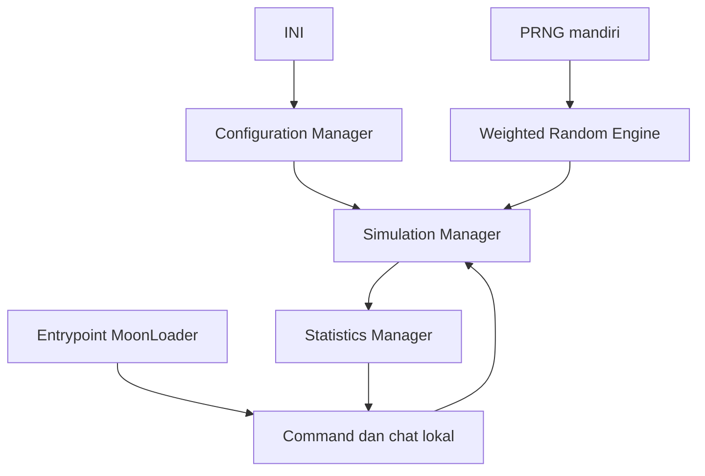

# AimLock 1.0.0

Dokumen arsip simulator 1.0.0. Source entrypoint versi ini sekarang disimpan lokal di `moonloader/archive/AimLock1.0.0.source.lua`. Artefak, konfigurasi, serta perintah simulator di bawah tetap berlaku untuk versi 1.0.0; SOP build lama menggambarkan build versi tersebut. Source `moonloader/AimLock.lua` dan alat build aktif sekarang menghasilkan versi kamera 1.1.0, dijelaskan pada [dokumentasi aktif](AimLock.md).

## Ruang lingkup

Source lokal `AimLock.lua` menggunakan modul `AimLockDistribution` untuk menghasilkan sampel kategori tubuh berdasarkan probabilitas yang dikonfigurasi. Versi publik adalah [AimLock1.0.0.lua](../moonloader/AimLock1.0.0.lua), yang membundel seluruh modul dalam satu file obfuscated. Simulasi hanya berjalan melalui `Simulation:run()` atau command `simulate`, tanpa mengamati atau memengaruhi combat game. Label tubuh adalah kategori statistik, bukan ID body part pada packet SA-MP.

## Struktur dan tanggung jawab

```text
moonloader/
  AimLock1.0.0.lua                    artefak distribusi obfuscated
  AimLock1.0.0.manifest.json          SHA256 dan identitas build
  AimLock.lua                         source lokal, diabaikan Git
  config/
    AimLock.ini                       konfigurasi yang dibaca saat startup
  lib/AimLockDistribution/             source lokal, diabaikan Git
    config.lua                        parser INI, default, validasi
    random.lua                        PRNG Park-Miller dengan state per instance
    engine.lua                        pemilihan interval berbobot
    statistics.lua                    hitungan, persentase, snapshot, reset
    simulation.lua                    batch dan akumulasi hasil
    integration.lua                   registry command, parsing, tabel chat lokal
tests/
  hit_distribution_spec.lua            pengujian core dan stub MoonLoader
docs/
  AimLock.md                          arsitektur dan SOP
tools/
  build-release.cjs                   bundler dan obfuscator
  package.json                       dependensi alat build
  package-lock.json                  versi dependensi yang dikunci
README.md                             instalasi dan penggunaan
```

`config.lua` memvalidasi data sebelum engine atau statistik dibuat. `simulation.lua` menghubungkan engine dan statistik tanpa ketergantungan game. `integration.lua` menerima adapter tiga fungsi untuk registry dan chat. Entrypoint memeriksa API/dependensi, memuat modul dan INI, menunggu SA-MP siap, mendaftarkan command, kemudian mempertahankan script dengan `wait(-1)`.

Bundle mempunyai registry modul privat per instance. Fungsi `require` di dalam masing-masing modul diarahkan ke registry tersebut, tanpa mengubah `package.loaded`, `package.preload`, atau `require` global. Karena itu versi publik tidak memerlukan folder modul source. Chunk mengembalikan accessor registry agar suite dapat menguji core bundle; MoonLoader tetap menjalankan hook global `main` seperti pada source.



## Technology stack dan dependensi

| Komponen | Kebutuhan |
| --- | --- |
| Bahasa core | Lua 5.1; kompatibel dengan LuaJIT 2.0/2.1 |
| Runtime game | GTA San Andreas Windows, SA-MP, MoonLoader |
| Integrasi command | SAMPFUNCS untuk opcode SA-MP |
| Library standar | `io`, `os`, `math`, `string`, `table`, `package` |
| Library eksternal saat runtime | Tidak ada |
| Tes biasa | Interpreter Lua 5.1 atau LuaJIT, tanpa framework |
| Build distribusi | Node.js, npm, LuaMin 1.0.4, LuaParse 0.3.1; versi dikunci di `tools/package-lock.json` |
| Tool verifikasi pada sesi pengembangan | Python 3.13 dan Lupa 2.8 di folder temporary; tidak diperlukan oleh game |

Tidak ada perubahan database, endpoint API, atau deployment otomatis. Tidak ada FFI, hook jaringan, akses memori game, atau ketergantungan SAMP.Lua.

## Konfigurasi

File yang dibaca adalah `<getWorkingDirectory()>/config/AimLock.ini`. Pada MoonLoader, working directory tersebut adalah direktori MoonLoader. Template lengkap tersedia di [file INI](../moonloader/config/AimLock.ini).

```ini
[general]
command=hitdist
seed=auto

[distribution]
torso=20
left_arm=20
right_arm=20
left_leg=15
right_leg=15
head=10
```

Nilai di atas mengikuti INI distribusi saat ini. `Config.defaults()` pada core tetap menyediakan preset awal 40/15/15/10/10/10 untuk pemakaian API; entrypoint selalu membaca INI dan tidak menggantinya otomatis dengan preset tersebut.

- Seluruh enam key `distribution` wajib ada. Setiap nilai harus angka finite pada rentang 0..100. Nol diizinkan.
- Total harus 100. Toleransi absolut `1e-7` hanya mengakomodasi representasi floating point, bukan mengoreksi konfigurasi yang jumlahnya salah. Engine menggunakan total tervalidasi sebagai lebar interval.
- Desimal memakai titik, contohnya `torso=37.5`. Notasi numerik yang diterima `tonumber` Lua juga didukung. Jangan memakai simbol `%` atau koma desimal.
- `[general]` boleh dihilangkan; defaultnya `command=hitdist` dan `seed=auto`. String kosong atau nilai yang salah tidak diganti diam-diam dengan default.
- `command` berisi 1..20 karakter ASCII, diawali huruf, diikuti huruf/angka/underscore, tanpa slash. Nama dinormalisasi menjadi huruf kecil.
- `seed` bernilai `auto` atau integer 1..2147483646. `seed=12345` mengulang urutan yang sama setelah instance dibuat ulang dengan konfigurasi sama dan urutan percobaan sama.
- Parser menerima spasi tepi, LF/CRLF, BOM UTF-8, komentar `;` atau `#`, termasuk komentar setelah nilai. Nama section dan key memakai huruf kecil.
- Section/key yang tidak dikenal, duplikat, baris rusak, probabilitas negatif, NaN/infinity, total salah, dan bagian tubuh yang hilang ditolak.
- File yang hilang, tidak dapat dibaca, atau tidak valid menghentikan startup dengan pesan di `moonloader.log`. File tidak dibuat atau ditimpa otomatis.

Perubahan INI diterapkan dengan reload script atau memulai ulang game. Statistik hanya disimpan di memori selama sesi; reload menghapus statistik. Tidak ada command reload atau penyimpanan statistik ke disk.

Contoh alternatif yang valid, hanya Head terpilih:

```ini
[general]
command=arfiehitdist
seed=12345

[distribution]
torso=0
left_arm=0
right_arm=0
left_leg=0
right_leg=0
head=100
```

## Algoritma Weighted Random

Untuk INI distribusi saat ini, engine membentuk interval kumulatif:

| Kategori | Interval |
| --- | --- |
| Torso | `[0, 20)` |
| Left Arm | `[20, 40)` |
| Right Arm | `[40, 60)` |
| Left Leg | `[60, 75)` |
| Right Leg | `[75, 90)` |
| Head | `[90, 100)` |

Setiap sampel mengambil `u` pada `[0,1)`, menghitung `r = u * total`, kemudian memilih interval pertama dengan `r < batas_atas`. Misalnya `r=52` memilih Right Arm. Bobot nol tidak dimasukkan ke interval, sehingga tidak dapat terpilih. Pemindaian memerlukan paling banyak enam perbandingan. Tidak ada pemilihan body part secara merata atau pemaksaan kuota setiap batch.

`random.lua` memakai Park-Miller:

```text
state_baru = (16807 * state_lama) mod 2147483647
u = (state_baru - 1) / 2147483646
```

Perkalian maksimum berada di bawah `2^53`, sehingga cocok dengan representasi `number` LuaJIT/Lua 5.1. Seed dipilih sekali saat instance dibuat. Mode `auto` mencampurkan waktu, waktu CPU, dan representasi identitas objek Lua, tanpa memanggil `math.randomseed` atau memakai state RNG script lain. Seed aktual ditampilkan oleh `/hitdist` dan tersedia melalui hasil `run()`.

Ini PRNG deterministik untuk simulasi, bukan sumber acak kriptografis. Seed otomatis tidak menjamin keunikan mutlak; seed tetap sengaja menghasilkan urutan berulang untuk reproduksi. Reset statistik tidak melakukan reseed. Algoritma tidak menjamin persentase persis sama dengan target pada 100, 500, atau 1000 sampel.

## Statistik dan batch

`Statistics:snapshot()` menghasilkan total serta enam baris dalam urutan tetap. Setiap baris berisi `key`, `label`, `count`, `target_percent`, `actual_percent`, dan `delta_pp`.

```text
actual_percent = count / total * 100
delta_pp = actual_percent - target_percent
```

Selisih adalah percentage points, bukan persentase relatif. Contoh: target 40% dan aktual 42% berarti `+2.00 pp`. Saat total nol, semua aktual ditampilkan 0% untuk menghindari pembagian nol; delta numeriknya masih `0 - target`, dan chat memberi catatan bahwa delta belum bermakna. Pembulatan dua angka desimal hanya diterapkan untuk tampilan, sehingga jumlah persentase yang ditampilkan dapat sedikit berbeda dari 100%.

`Simulation:run(100|500|1000)` membentuk statistik batch terlebih dahulu, lalu menggabungkannya ke statistik sesi hanya jika seluruh sampel berhasil. Error sumber random tidak meninggalkan statistik batch parsial dalam akumulasi. State RNG yang sudah digunakan tidak di-rollback. Hasil mengandung `trials`, `seed`, `batch`, dan `cumulative`.

Menjalankan 100, lalu 500, lalu 1000 percobaan menghasilkan total kumulatif 1600. Snapshot dikembalikan sebagai salinan; mengubah snapshot tidak mengubah hitungan internal. Batas total adalah `2^53-1`, sesuai rentang integer tepat pada Lua number; lakukan reset jika mencapai batas.

## API core untuk pengembangan

API berikut ditujukan untuk source pengembangan lokal, yang tidak disertakan dalam repository distribusi. Path module memakai folder `moonloader/lib` yang tersedia pada MoonLoader. Untuk interpreter mandiri, tambahkan path tersebut terlebih dahulu:

```lua
package.path = './moonloader/lib/?.lua;' .. package.path

local Config = require 'AimLockDistribution.config'
local Simulation = require 'AimLockDistribution.simulation'

local config = Config.defaults()
config.general.seed = 12345
local simulator = assert(Simulation.new(config))
local result = assert(simulator:run(100))

print('Batch:', result.batch.total, 'Sesi:', result.cumulative.total)
for _, row in ipairs(result.batch.rows) do
    print(string.format('%s | %d | %.2f%% | %.2f%% | %+.2f pp',
        row.label, row.count, row.target_percent, row.actual_percent, row.delta_pp))
end
simulator:reset()
```

| Modul | API utama |
| --- | --- |
| Config | `defaults()`, `validate(config)`, `validate_distribution(weights)`, `parse(text)`, `load(path)` |
| Random | `new(seed)`, `rng:next()`; `rng.seed` adalah seed awal |
| Engine | `new(weights, random_unit_opsional, seed_opsional)`, `engine:pick()` |
| Statistics | `new(weights)`, `stats:record(key, count_opsional)`, `stats:snapshot()`, `stats:reset()` |
| Simulation | `new(config, random_unit_opsional)`, `sim:run(trials)`, `sim:snapshot()`, `sim:reset()`, `sim:configuration()` |
| Integration | `new(simulation, api)`, `integration:register()`, `integration:handle(params)` |

Validasi dan operasi yang bisa gagal mengembalikan `nil, pesan_error`. `validate_distribution` mengembalikan `weights_copy, total` saat berhasil. `record` mengembalikan `true` dan menerima jumlah nol atau integer positif. Fungsi reset tidak mengembalikan data. Konstruktor `Integration` menerima simulator yang sudah valid; adapter berisi `is_command_defined`, `register_command`, dan `add_chat_message`.

Fungsi `random_unit` opsional berguna untuk tes interval deterministik. Nilai harus angka finite pada `[0,1)`; exception, NaN, infinity, atau nilai di luar interval ditolak. Field internal instance tidak termasuk kontrak konfigurasi runtime; ubah probabilitas melalui INI dan buat ulang simulator.

## SOP penggunaan command

| Command default | Hasil |
| --- | --- |
| `/hitdist` | Target distribusi, seed aktual, dan bantuan |
| `/hitdist stats` | Tabel kumulatif sesi |
| `/hitdist reset` | Semua hitungan menjadi nol; RNG berlanjut |
| `/hitdist simulate 100` | Tabel batch 100 sampel dan total kumulatif |
| `/hitdist simulate 500` | Tabel batch 500 sampel dan total kumulatif |
| `/hitdist simulate 1000` | Tabel batch 1000 sampel dan total kumulatif |

Argumen lain, jumlah yang berbeda, atau token ekstra hanya menampilkan bantuan dan tidak menambah statistik. Tabel chat memakai pemisah `|` sehingga kolom tetap dapat dibaca pada font proporsional. Tidak memakai dialog atau RPC, dan tidak mengirim command ke server.

Sebelum registrasi, integrasi memeriksa `sampIsChatCommandDefined` dan hasil `sampRegisterChatCommand`. Command yang sudah terdaftar ditolak; pilih nama lain di `general.command`, lalu reload. Pemeriksaan ini berlaku untuk registry client pada saat startup. API tersebut tidak dapat mendeteksi seluruh nama command server atau mencegah script lain yang mendaftarkan nama sama setelahnya.

## API MoonLoader yang dipakai

Nama dan signature diverifikasi terhadap [referensi MoonLoader oleh THE-FYP](https://gist.github.com/THE-FYP/abc6f8bea87f4cb42331fc6dd7a84576). Referensi mencakup fungsi SA-MP berbasis opcode SAMPFUNCS.

| Fungsi | Pemakaian |
| --- | --- |
| `script_name`, `script_author`, `script_version`, `script_description` | Metadata script |
| `isSampLoaded()`, `isSampfuncsLoaded()` | Pemeriksaan dependensi sebelum memanggil opcode SA-MP |
| `isSampAvailable()` | Menunggu struktur SA-MP siap |
| `getWorkingDirectory()` | Lokasi konfigurasi di direktori MoonLoader |
| `sampIsChatCommandDefined(command)` | Pemeriksaan bentrok registry client |
| `sampRegisterChatCommand(command, callback)` | Registrasi command lokal, hasil boolean diperiksa |
| `sampAddChatMessage(text, color)` | Pesan dan tabel lokal |
| `wait(100)`, `wait(-1)` | Menunggu kesiapan dan mempertahankan callback |

Jika fungsi wajib tidak tersedia atau SA-MP/SAMPFUNCS belum dimuat, `main()` berhenti dan menulis alasan ke log. Modul core tetap dapat diuji tanpa API game. Opcode combat, packet, damage, aim, dan manipulasi pemain tidak digunakan.

## Pengujian dan batas verifikasi

Jalankan dari root repository:

```powershell
luajit tests/hit_distribution_spec.lua moonloader/AimLock1.0.0.lua
lua tests/hit_distribution_spec.lua moonloader/AimLock1.0.0.lua
```

Untuk source lokal, jalankan perintah tanpa argumen nama artefak. Pada mode artefak, suite membaca modul langsung dari bundle dengan pemuatan modul eksternal diblokir. Kasus file modul hilang pada source menjadi pembuktian bahwa bundle tetap dapat startup tanpa file modul eksternal.

Suite menguji konfigurasi 100%, konfigurasi salah, total/bobot negatif/nol, satu kategori 100%, batas interval deterministik, PRNG dengan seed tetap, batch 100/500/1000, akumulasi/reset, persentase, penanganan error sumber random, parsing command, dan registrasi menggunakan stub. Tes tidak menuntut hasil acak identik dengan target. Distribusi diverifikasi lewat interval berbobot deterministik dan pemeriksaan statistik pada sampel ber-seed tetap.

Tool pengujian pada mesin pengembangan menggunakan runtime native yang dibundel oleh [Lupa](https://pypi.org/project/lupa/). Tool ini ditempatkan di folder temporary, tidak ditambahkan sebagai dependensi project, dan bukan MoonLoader.

Hasil verifikasi pada 17 November 2026, Windows x64:

| Runtime embedded native | Source lokal | Bundle obfuscated |
| --- | --- | --- |
| LuaJIT 2.0.1774896119 | 41 lulus, 0 gagal | 41 lulus, 0 gagal |
| LuaJIT 2.1.1774896198 | 41 lulus, 0 gagal | 41 lulus, 0 gagal |
| Lua 5.1 | 41 lulus, 0 gagal | 41 lulus, 0 gagal |

Seluruh file Lua pada `moonloader/` juga berhasil dikompilasi. Pemeriksaan tambahan menjalankan batch 100/500/1000 dengan total 1600 dan mencocokkan satu juta langkah PRNG terhadap perhitungan integer Python independen: seed 1 berakhir pada state `1227283347`. Pemeriksaan tambahan tersebut lulus pada LuaJIT 2.0/2.1 dengan JIT aktif maupun nonaktif, serta Lua 5.1. Ini verifikasi embedded runtime Windows x64, bukan embedding MoonLoader Windows x86.

Pengujian dalam game belum dijalankan. Tes core dan stub tidak membuktikan kompatibilitas binary GTA/SA-MP/SAMPFUNCS/MoonLoader yang terpasang, lifecycle reload dalam game, tampilan chat, atau bentrok dengan seluruh script/server pengguna. Sebelum digunakan, periksa manual:

1. Instal file sesuai README dan pastikan pesan startup serta `/hitdist` muncul.
2. Jalankan seluruh ukuran batch; pastikan total `stats` menjadi 1600, lalu `reset` menjadi nol.
3. Ubah INI dengan total valid, reload, dan periksa target. Coba total tidak valid; pastikan pesan log menjelaskan kegagalan dan file tetap utuh.
4. Daftarkan command yang sama dari script uji terpisah lebih dulu; pastikan simulator menolak registrasi, lalu gunakan nama alternatif di INI.
5. Periksa pembacaan tabel dengan pengaturan font/chat pengguna dan konfirmasi output hanya terlihat di client lokal.

SOP perubahan berikutnya: baca dokumentasi terkait, ubah modul dengan tanggung jawab yang sesuai, jalankan suite pada runtime yang tersedia, lalu perbarui struktur, kontrak konfigurasi/API, dependensi, dan bukti pengujian yang benar-benar berubah. Simpan keterbatasan pengujian yang belum diselesaikan.

## SOP build dan publikasi

Source pengembangan `moonloader/AimLock.lua` beserta enam modul di `moonloader/lib/AimLockDistribution/` tetap disimpan lokal melalui `.gitignore`. Repository publik berisi artefak obfuscated, INI, manifest, dokumentasi, suite, dan alat build. Source lokal diperlukan untuk membangun ulang; clone repository saja cukup untuk menjalankan tes artefak, tetapi tidak cukup untuk membangun artefak baru.

`.gitattributes` mempertahankan byte file distribusi, manifest, dan INI tanpa konversi newline Git agar hash dalam manifest konsisten setelah clone atau download.

```powershell
npm.cmd ci --prefix tools --ignore-scripts --no-audit --no-fund
npm.cmd run build --prefix tools
npm.cmd run check --prefix tools
```

Build menggunakan [LuaMin](https://github.com/mathiasbynens/luamin) untuk minifikasi dan penggantian nama variabel lokal, serta [LuaParse](https://github.com/fstirlitz/luaparse) untuk validasi sintaks Lua 5.1 dan lokasi literal string. Enam modul dibundel dalam closure terpisah, kemudian literal string dikonversi ke escape desimal. Metadata, identitas author dari source, nama fungsi global `main`, serta kontrak command tetap dipertahankan. Obfuscation tidak memakai `loadstring`, bytecode, download, atau eksekusi payload eksternal.

Versi filename diambil dari `script_version` pada source. Versi ini menghasilkan `AimLock1.0.0.lua` dengan enam modul dan 164 string yang di-encode. [Manifest build](../moonloader/AimLock1.0.0.manifest.json) memuat SHA256 artefak, INI yang dibagikan, setiap source, dan gabungan source. Header artefak juga memuat hash gabungan source. `check` membangun ulang hasil di memori dan menolak artefak/manifest yang berbeda; file source asli tidak ditimpa. Tidak ada timestamp acak pada hasil build sehingga source yang sama menghasilkan artefak yang sama.

Obfuscation mempersulit pembacaan kode dan tidak menjamin kode tidak dapat dipulihkan. Konfigurasi tetap terbaca agar probabilitas dan nama command dapat diedit. Pasang hanya `AimLock1.0.0.lua` bersama `config/AimLock.ini`; jangan menjalankan source dan artefak bersamaan karena keduanya memakai command yang sama.

Sebelum publikasi, jalankan suite pada source dan artefak, periksa `npm.cmd run check --prefix tools`, lalu pastikan `git check-ignore` melindungi source dan `tools/node_modules`. Stage artefak, manifest, konfigurasi, dokumentasi, tes, dan alat build secara eksplisit. Periksa daftar staged, commit, dan push ke branch `master` pada remote `samp`. Setelah push, cocokkan hash commit lokal dengan `git ls-remote samp refs/heads/master`.
